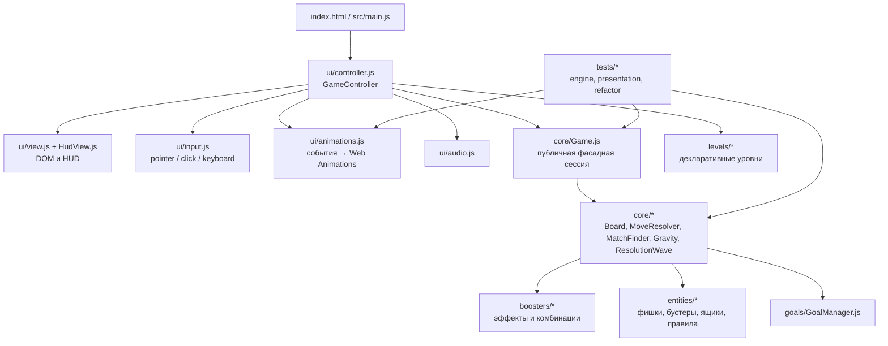
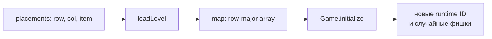
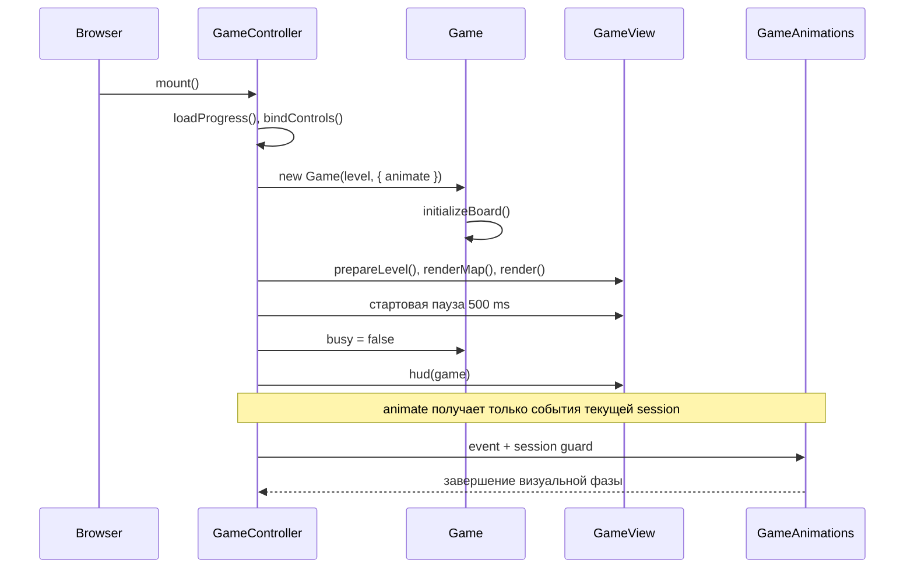
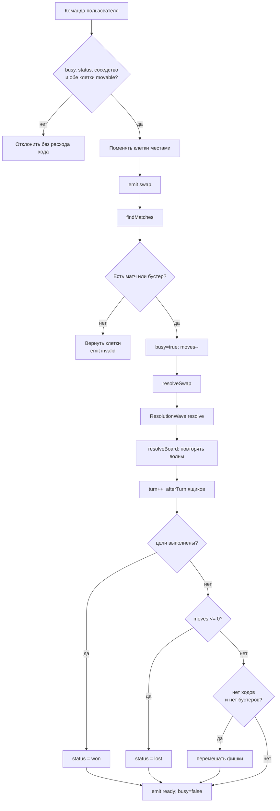
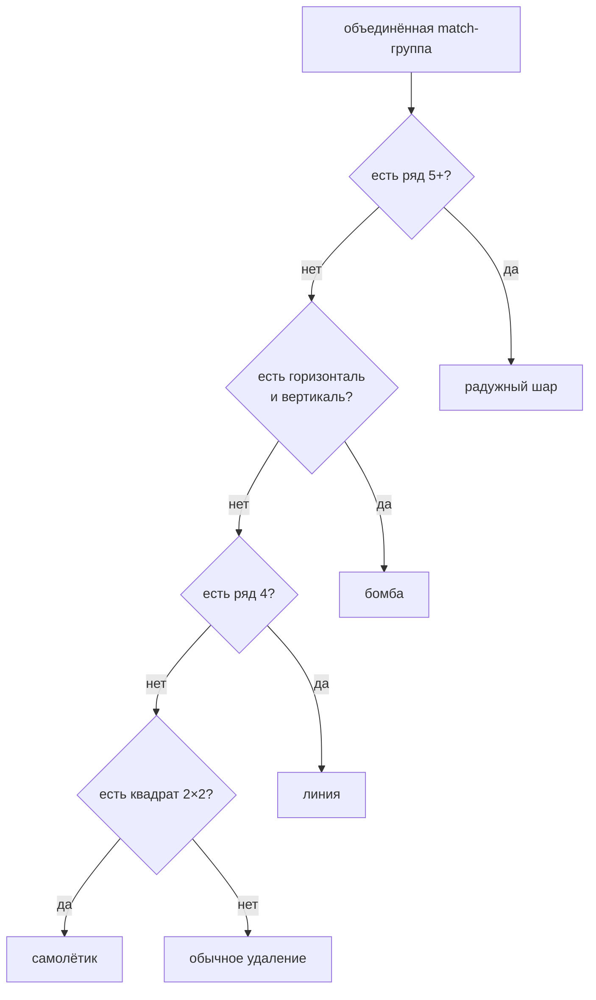
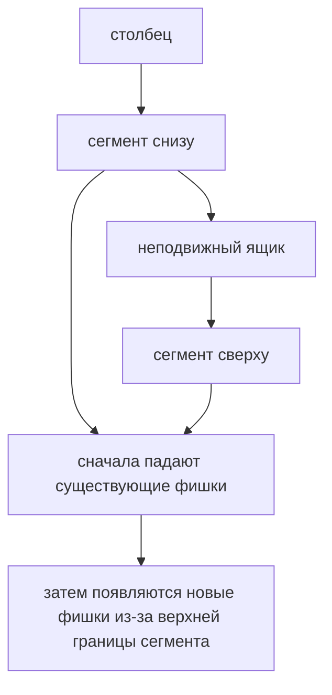

# Bloom · Match-3 — описание кодовой базы

## 1. Назначение проекта

Bloom — самостоятельная браузерная match-3 игра без серверной части и runtime-зависимостей. Приложение запускается как статический сайт, а игровая логика может использоваться отдельно от DOM в Node.js-тестах.

Ключевая архитектурная идея — разделение на два слоя:

- **движок** (`src/core/`, `src/boosters/`, `src/entities/`, `src/goals/`) хранит состояние и применяет правила;
- **представление** (`src/ui/`) принимает события движка, рисует снимки поля, проигрывает анимации и обрабатывает ввод.

Движок не импортирует UI и не обращается к DOM. Связь выполняется через асинхронный callback `animate(event, game)`, передаваемый в `Game`.

### Границы документа

`README.md` содержит пользовательские инструкции, спецификацию механик, команды запуска и ограничения проекта. Этот файл — техническое описание реализации, составленное по исходникам и тестам. Если поведение в README и коде расходится, источником проверяемого поведения считаются исходники и тесты.

## 2. Структура проекта



### Точки входа

- `src/main.js` создаёт `GameController`, передаёт ему список уровней и вызывает `mount()`.
- `src/app.js` — совместимая старая точка входа, которая импортирует `main.js`.
- `src/engine.js` — публичный API движка для браузера и Node-тестов: экспортирует `Game`, фабрики сущностей, палитру, список бустеров и реестр правил ящиков.

### Команды

- `npm run dev` — статический сервер на порту 4173.
- `npm test` — Node test runner для всех `tests/*.test.mjs`.
- `npm run build` — копирование готового приложения в `dist/`.
- `npm run format:check` — проверка Prettier.

## 3. Модель данных

### 3.1. Игровая сессия

`Game` — объект одной попытки прохождения уровня. Он владеет:

| Поле           | Назначение                                 |
| -------------- | ------------------------------------------ |
| `level`        | конфигурация текущего уровня               |
| `rows`, `cols` | размеры поля                               |
| `field`        | экземпляр `Board`                          |
| `moves`        | оставшиеся ходы                            |
| `score`        | очки                                       |
| `collected`    | счётчики целей по ключам                   |
| `status`       | `playing`, `won` или `lost`                |
| `busy`         | блокировка команд во время разрешения хода |
| `turn`         | число принятых ходов/активаций             |
| `random`       | внедряемый генератор случайных чисел       |
| `animate`      | внедряемый асинхронный канал событий       |

Для обратной совместимости `game.board` остаётся живым массивом клеток, хотя внутренняя работа выполняется через `Board`.

### 3.2. Клетки и элементы

Каждая клетка содержит `null` либо объект элемента с общей формой `Piece` из `src/types.js`:

```js
// Фишка
{ kind: 'gem', color: 0, id: 101 }

// Бустер
{ kind: 'booster', type: 'line', axis: 'v', id: 102 }

// Ящик
{ kind: 'box', type: 'colored', hp: 2, color: 3,
  contains: { kind: 'gem', color: 1, id: 103 }, id: 104 }
```

`id` — не координата и не постоянный идентификатор уровня. Это runtime-идентичность, по которой UI сопоставляет DOM-тайл с движущимся объектом. `gem`, `booster`, `box` создают новые ID; `cloneElement` рекурсивно клонирует вложенное содержимое с новыми ID.

Палитра цветов задаётся в `entities/Piece.js`: `coral`, `gold`, `green`, `blue`, `purple`, `pink`. Уровень использует первые `level.colors` цветов.

### 3.3. Декларативный уровень

`src/levels/levels.js` хранит 10 шаблонов. `LevelLoader.loadLevel()` разворачивает разреженный список `placements` в плоский массив `rows * cols`:



Значения карты:

- `'?'` — случайная фишка;
- число `0..colors-1` — фиксированный цвет;
- объект бустера или ящика — фиксированный элемент, клонируемый при старте.

Цели имеют строковые ключи: `color:N`, `booster`, `booster:type`, `box`, `box:type`. `GoalManager` не знает предметных правил: он только увеличивает счётчики, вычисляет остаток и проверяет, выполнены ли все цели.

## 4. Поток запуска и владение сессией



`GameController.session` защищает от устаревших анимаций: при открытии нового уровня увеличивается номер сессии, а callback старой сессии перестаёт изменять интерфейс. Это особенно важно при автоматическом переходе после победы, ручном нажатии кнопки результата и отмене визуальных эффектов.

## 5. Жизненный цикл хода

Принятый обмен и ручная активация бустера проходят через `MoveResolver.js`.



Особенности:

1. Невалидный обмен восстанавливается и не уменьшает `moves`.
2. Обмен с бустером считается допустимым даже без обычного матча.
3. Победа проверяется раньше поражения: выполнение целей последним ходом выигрывает уровень.
4. После принятого хода меняющиеся ящики (`cycling`) меняют цвет ровно один раз, после всех каскадов.
5. При тупике перемешиваются только фишки; неподвижные ящики сохраняются.
6. Лимит `MAX_CASCADE_WAVES = 200` защищает от бесконечной цепочки.

## 6. Поиск матчей и создание бустеров

`MatchFinder.findMatches()` за один проход ищет:

- горизонтальные серии длиной от 3;
- вертикальные серии длиной от 3;
- квадраты 2×2.

Пересекающиеся паттерны объединяются в одну группу. `MatchBooster.classifyGroup()` определяет один создаваемый бустер по приоритету:



Место создания выбирается в `ResolutionWave.addMatches()`:

1. сначала ищется участвовавшая в обмене клетка из `game.preferred`;
2. если её нет, берётся центральная клетка группы.

Сбор фишек группы засчитывается даже в клетке, где появится бустер.

## 7. Волнa разрешения и цепные реакции

`ResolutionWave` — центральный объект одного удаления/активации. Он сначала накапливает последствия, затем ждёт визуальную фазу и только после этого мутирует поле.

```mermaid
sequenceDiagram
    participant R as MoveResolver
    participant W as ResolutionWave
    participant Q as queue
    participant B as Booster handlers
    participant E as animate
    participant G as Game.board

    R->>W: resolve(matches, activation, combo)
    W->>W: addMatches()
    W->>W: combine(), если обменялись два бустера
    W->>Q: начальные активации
    loop пока queue не пуста
        W->>Q: взять следующий бустер
        W->>B: describe(effect)
        B-->>W: positions + effect metadata
        W->>W: hit() / hitAll(); enqueue задетых бустеров
    end
    W->>W: damagedBoxes()
    W->>E: emit remove
    E-->>W: эффекты и удаление завершены
    W->>G: applyDamage()
    W->>G: gravity()
```

Состояние волны разделено по ответственности:

- `hits` — все задетые позиции;
- `directHits` — позиции, затронутые непосредственно эффектом бустера;
- `matchColors` — цвета матчей, попавших в клетку;
- `queue` — ожидающие активации бустеры;
- `activated` — защита от повторной активации в этой волне;
- `creations` — бустеры, которые появятся на месте матча после удаления;
- `transformedGems` — исходные фишки при радужных преобразованиях.

Важный порядок: сначала рассчитываются все эффекты и урон, затем UI проигрывает `remove`, затем `applyDamage`, затем `gravity`. Поэтому анимация не наблюдает промежуточное состояние, которое ещё не было утверждено логикой.

Ящик теряет максимум одну жизнь за волну: несколько прямых попаданий и соседних цветовых матчей объединяются в одну запись `hit`.

## 8. Бустеры и комбинации

Обычные эффекты реализованы отдельными классами с чистым методом `describe()`:

| Бустер    | Область                                            |
| --------- | -------------------------------------------------- |
| `line`    | весь ряд или столбец по `axis`                     |
| `bomb`    | квадратный радиус 2, то есть до 5×5                |
| `rainbow` | все фишки выбранного цвета                         |
| `plane`   | соседние клетки и одна приоритетная удалённая цель |

`BoosterCombinationResolver` сортирует два типа и обрабатывает все 10 неупорядоченных комбинаций:

| Комбинация        | Результат                                                      |
| ----------------- | -------------------------------------------------------------- |
| line + line       | горизонтальная и вертикальная линии                            |
| line + bomb       | расширенный крест: 3 ряда и 3 столбца                          |
| bomb + bomb       | область 9×9                                                    |
| plane + line      | самолётик доставляет линию к цели                              |
| plane + bomb      | самолётик доставляет бомбу к цели                              |
| plane + plane     | три разные приоритетные цели                                   |
| rainbow + line    | фишки выбранного цвета превращаются в линии и активируются     |
| rainbow + bomb    | фишки выбранного цвета превращаются в бомбы и активируются     |
| rainbow + plane   | фишки выбранного цвета превращаются в самолёты и активируются  |
| rainbow + rainbow | задеваются все клетки, но правила ящиков всё равно применяются |

При выборе цвета радужный шар сначала учитывает незавершённые цветовые цели (`bestColor`), затем количество фишек на поле. При выборе цели самолётик предпочитает незавершённые цели, затем ящики, бустеры и фишки; `blocker` исключается.

## 9. Ящики и расширяемые правила

Ящик — неподвижный элемент с `hp`, цветом и опциональным `contains`. Общая механика урона находится в `ResolutionWave`, а политика конкретного типа — в `entities/obstacles/rules.js`.

| Тип       | Правило `canDamage`                           | После хода                |
| --------- | --------------------------------------------- | ------------------------- |
| `wood`    | любой соседний матч или прямой бустерный удар | нет                       |
| `colored` | только соседний матч собственного цвета       | нет                       |
| `cycling` | только соседний матч текущего цвета           | цвет +1 по модулю палитры |
| `blocker` | никогда                                       | нет                       |

Прямой удар бустера помечается через `direct`, а цветовой урон — множеством `colors`. Это позволяет цветным и cycling-ящикам игнорировать прямые эффекты без специальных ветвлений в каждом бустере.

При разрушении ящика:

1. счётчики `box` и `box:type` увеличиваются;
2. начисляются 100 очков;
3. ящик заменяется клоном `contains` либо `null`;
4. новый элемент участвует в следующей гравитации, но не получает повторный урон текущей волны.

Новый тип регистрируется без изменения ядра:

```js
registerElement('armor', {
  canDamage: (item, hit) => hit.direct,
  afterTurn: (item, colorCount) => {
    // необязательное правило конца хода
  },
});
```

## 10. Гравитация и секции поля

`Gravity.calculateGravity()` не изменяет входной массив. Он создаёт копию, уплотняет каждый столбец снизу вверх и возвращает:

- новый массив `cells`;
- список `falls` с траекториями существующих и новых фишек.

Ящики делят столбец на независимые свободные сегменты:



Для каждой траектории сохраняются `from`, `to`, `col`, `segmentTop`, `segmentBottom`, `spawn`. UI использует эти поля для обрезки появляющейся фишки по границе сегмента. Сначала завершается падение уже существующих фишек, затем отдельной фазой появляются новые.

Порядок вызовов генератора случайных чисел является частью совместимости: тесты фиксируют порядок spawn и сравнивают снимки движка.

## 11. UI и асинхронные события

`GameView` не изменяет игровое состояние. Он сопоставляет элементы поля с DOM-кнопками по `data-id`, обновляет позицию через `transform` и рисует содержимое через `presentation.js`.

```mermaid
flowchart LR
    Engine[Game.emit(event)]
    Controller[GameController callback]
    Anim[GameAnimations.play]
    Draw[GameView.draw(snapshot)]
    Effect[эффекты бустеров]
    Remove[удаление / урон]
    Fall[падение существующих]
    Spawn[появление новых]
    Hud[HudView.hud]

    Engine --> Controller --> Anim
    Anim --> Draw
    Anim --> Effect --> Remove --> Fall --> Spawn
    Anim --> Hud
```

Типы событий движка:

- `swap` — принятый обмен;
- `invalid` — возврат недопустимого обмена;
- `cascade` — начало очередной волны;
- `remove` — рассчитанные удаления, урон, эффекты и создания;
- `fall` — новое поле и траектории;
- `shuffle` — перемешивание при тупике;
- `ready` — завершение хода.

`GameAnimations` ждёт завершения каждой функционально значимой фазы. В частности, `remove` завершает эффекты и уничтожение до изменения состояния движка, а `fall` разделяет survivors и spawned. Режим reduced motion сокращает длительности, но сохраняет ожидание завершения Promise.

### Ввод

`ui/input.js` поддерживает:

- drag по соседней клетке;
- последовательный click по двум клеткам;
- повторный выбор бустера для самостоятельной активации;
- стрелки клавиатуры для перемещения фокуса;
- делегирование `choose()` и `swap()` в контроллер.

`GameController` проверяет `busy`, `status`, неподвижные ящики и показывает подсказки/сообщения. UI-чит вызывает только `game.forceOutcome()`, а не меняет счётчики напрямую.

## 12. Сохранение прогресса и переходы

`ui/progress.js` хранит в `localStorage` только навигационный прогресс:

```js
{ unlocked: 1, level: 0 }
```

Незавершённое поле не сериализуется. После победы открывается следующий уровень и прогресс сохраняется. `showOutcome()` показывает модальное окно, затем через 2200 мс переходит дальше; повторное нажатие защищено флагом `hasContinued`, а сессия дополнительно проверяется.

После последнего уровня индекс циклически возвращается к нулю; после поражения текущий уровень запускается заново.

## 13. Проверки и гарантии

Тесты разделены на три группы:

### `tests/engine.test.mjs`

Проверяет предметные правила: стартовые поля 10 уровней, распознавание фигур, валидность обменов, создание бустеров, каскады, цели, все комбинации, правила ящиков, вложенность, rainbow-преобразования, deadlock shuffle и 500 симулированных ходов на каждом уровне.

### `tests/refactor.test.mjs`

Проверяет сохранение поведения после рефакторинга: 120 детерминированных ходов сравниваются по SHA-256 снимкам поля, событиям, очкам, целям, ходам и числу вызовов RNG. Также проверяются неизменность входа гравитации, порядок spawn и блокировка читов во время хода.

### `tests/presentation.test.mjs`

Проверяет презентационный контракт: порядок эффектов, ожидание удаления, отмену устаревших анимаций, reduced motion, transform-позиционирование, переходы после результата и clipping появления в нижних сегментах.

Главные инварианты:

1. стартовое поле не содержит матчей и имеет хотя бы один допустимый ход;
2. неподвижные ящики не перемещаются при гравитации и shuffle;
3. недопустимый обмен не расходует ход;
4. один бустер активируется не более одного раза за волну;
5. один ящик получает максимум один урон за волну;
6. победа на последнем ходу имеет приоритет над поражением;
7. UI ждёт завершения визуальной фазы перед следующим изменением поля.

## 14. Как расширять проект

### Новый уровень

1. Добавить объект в `src/levels/levels.js`.
2. Задать `rows`, `cols`, `colors`, `moves`, `goals` и `placements`.
3. Использовать фабрики `gem`, `booster`, `box` либо совместимые объекты.
4. Добавить тест на стартовое поле и цели, если уровень вводит новую комбинацию правил.

### Новый бустер

1. Создать класс в `src/boosters/` с чистым `describe(game, index, axis, color, excluded)`.
2. Добавить обработчик в `ResolutionWave`.
3. Добавить тип в `BOOSTERS`, презентацию и SVG/UI-эффект.
4. Расширить комбинации и тесты.

### Новый ящик

1. Зарегистрировать `canDamage`/`afterTurn` через `registerElement`.
2. Добавить SVG и выбор текстуры в `ui/presentation.js`.
3. Добавить цели и тесты прямого, цветового и каскадного урона.

## 15. Ограничения и технический долг

- Публичный API намеренно допускает изменение живого `game.board`; это обратная совместимость, но она снижает инкапсуляцию.
- Ошибка внешнего обработчика `animate` может прервать ход без общего отката состояния.
- Отмена старой Web Animation безопасна для новой сессии, но не является транзакционным откатом уже применённых правил.
- Случайность внедрена через `random`, поэтому порядок генерации — наблюдаемая часть поведения и должен учитываться при изменении гравитации, урона или уровня.

## 16. Краткая карта ответственности

| Модуль                     | Ответственность                            | Не должен делать                  |
| -------------------------- | ------------------------------------------ | --------------------------------- |
| `core/Game.js`             | фасад сессии, счётчики, публичные операции | рисовать DOM                      |
| `core/Board.js`            | координаты, обмен, геометрия поля          | разрешать цели и урон             |
| `core/MoveResolver.js`     | валидность хода, каскады, конец хода       | знать детали SVG                  |
| `core/ResolutionWave.js`   | очередь эффектов, урон, удаление           | ждать DOM напрямую                |
| `core/Gravity.js`          | чистый расчёт падения                      | менять входной массив             |
| `boosters/*`               | геометрия эффектов                         | менять поле напрямую              |
| `entities/*`               | форма элементов и правила ящиков           | управлять ходом                   |
| `goals/*`                  | счётчики и проверка целей                  | выбирать визуальное представление |
| `ui/controller.js`         | координация сессии и команд                | реализовывать match-правила       |
| `ui/view.js`, `HudView.js` | DOM и HUD                                  | менять состояние движка           |
| `ui/animations.js`         | визуальная последовательность              | решать, какой урон допустим       |
| `tests/*`                  | регрессионные контракты                    | быть runtime-зависимостью         |
